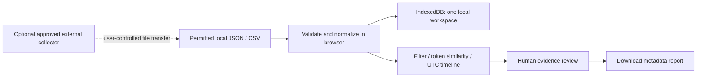

# Architecture and hosting boundaries

Decision: React + TypeScript + Vite, Papa Parse for CSV, idb-keyval over browser IndexedDB, CSS timeline visualization, deterministic TypeScript token analysis. All production runtime code executes in the browser. Build dependencies are local/CI only. No paid keys or services required.

## Why IndexedDB first

The bounded 2,000-record MVP needs simple persistence, not a SQL engine. IndexedDB works on static hosting without special headers or heavy WASM downloads. DuckDB-WASM is a plausible later option for columnar files, SQL and larger local datasets, but is not installed or claimed to be integrated. Its assets, worker setup, memory, browser support and possible cross-origin isolation requirements must be validated against Pages before adoption. Moving compute to a Web Worker is the earlier priority.

Current similarity is O(n²) on the UI thread, with token sets computed once per analysis. The input cap limits exposure but does not guarantee responsiveness on every device. Filtering and threshold changes recompute pairs. Large-pair output renders 40 pairs and exports metadata for all computed pairs. Daily counts show observed volume, never population-normalized rates. There is no actor graph because reliable behavioral inference needs better evidence and validation.

## Boundaries

Pages serves static files. It cannot execute Python, protect secrets, collect Reddit data, or run background jobs. GitHub Actions is CI/deployment here, not an unattended data collector. Code may be open source while data access remains restricted.

Optional future external collector: use Reddit-approved credentials and scope; record collection tool/version, permission basis, collection window, query and known omissions; minimize fields; implement deletion/retention and rate limits. It should export a file for explicit import, with no browser secrets or automatic backend connection. Local execution is sufficient for occasional collection. Persistent scheduling and shared services require separate hosting and operations.

## Data lifecycle and provenance

Original bytes → SHA-256 → parsed rows → normalized minimal records → IndexedDB. Original file bytes are not saved by the app. Title/text (20k-character cap), ID, subreddit, date, safe permalink and row survive; author and arbitrary fields do not. The acquisition note is user-supplied and unverified. Original exports can contain identifying material; keep them privately and honor deletions. One import replaces the existing workspace. Data is browser-origin scoped, unencrypted, and may be evicted by the browser. Reports include method, threshold, filter, IDs, rows, scores and file metadata. They do not include source text; reproducibility requires the retained permitted original file.

Privacy constraints: no third-party runtime network resources; CSP restricts connections to self (and loopback WebSocket for development). React escapes imported text; no imported HTML rendering. Permalinks allow HTTPS Reddit hosts only. No service worker, offline-install claim, remote model or telemetry. Hosting requests and explicit source-link visits still have external metadata exposure.

## Release checks

`npm test` checks parsing, minimization, unsafe links, malformed inputs and matching behavior; `npm run build` checks TypeScript and production compilation. CI validates PRs and deploys only main. Browser storage/rendering should also be tested on current Firefox, Chromium and Safari; automated end-to-end coverage is a roadmap item.
